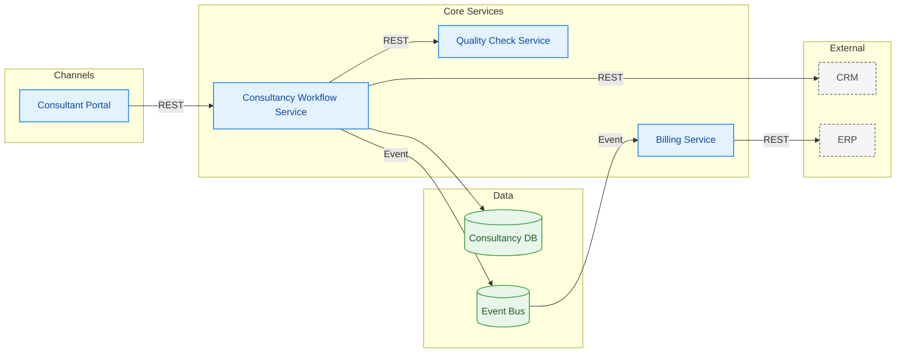

# Architecture / component diagram

## Scopo
Mostrare **componenti, layer, integrazioni e confini** di un sistema (cosa c'è, cosa parla con cosa).

## Quando usarlo
- Overview tecnica per stakeholder, ADR, onboarding
- Confini tra sistemi interni ed esterni, flussi di dati principali

## Quando NON usarlo
- Serve l'ordine temporale delle chiamate → sequence.

## Come costruirlo
1. `flowchart LR` con un `subgraph` per layer/boundary (es. *Channels*, *Core Services*, *Data*, *External*).
2. **Palette propria**: la semantica status/action/decision NON si applica qui (i componenti non sono azioni). Usa:
   - `component` → azzurro chiaro (servizi interni)
   - `datastore` → verde chiaro, forma cilindro `[( )]`
   - `external` → grigio chiaro tratteggiato (sistemi di terzi)
3. Esporta sempre i `classDef`, come per i flowchart.
4. Etichetta gli archi con il tipo di integrazione (`REST`, `Event`, `Batch`), non con frasi lunghe.
5. Un solo livello di dettaglio per diagramma; per scendere di livello fai un secondo diagramma.

## Esempio finito

