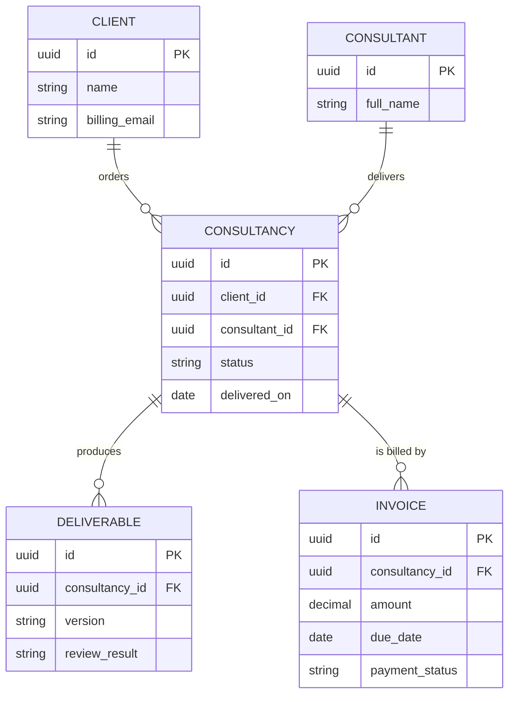

# ER diagram

## Scopo
Mostrare **entità, attributi e relazioni** (cardinalità) di un modello dati.

## Quando usarlo
- Design o documentazione di schema
- Chiarire "cosa è legato a cosa" prima di scrivere codice (partire dal domain model)

## Quando NON usarlo
- Serve il comportamento nel tempo → flowchart / sequence / state.

## Come costruirlo
1. Entità al singolare, MAIUSCOLO (`CONSULTANCY`), attributi in inglese.
2. Dichiara tipo, nome, e chiave (`PK`, `FK`) per ogni attributo.
3. Cardinalità: `||--o{` (uno a molti opzionale), `||--||` (uno a uno), `}o--o{` (molti a molti, da risolvere con entità ponte).
4. Etichetta ogni relazione con un verbo (`"has"`, `"produces"`).
5. **Colori**: l'ER non ha un equivalente portabile di status/action/decision; non forzarlo. Lascia lo stile di default per massimizzare la portabilità e dichiaralo come scelta.

## Esempio finito

