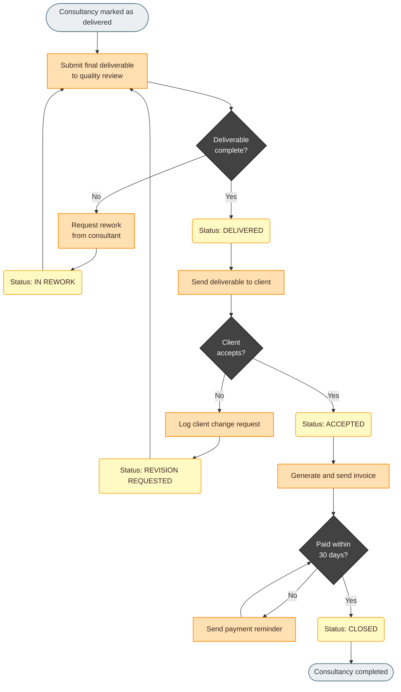

# Process flowchart

## Scopo
Descrivere un processo end-to-end: trigger, azioni, aggiornamenti di stato, decisioni, rework ed esiti finali. È il tipo **di default** di questa skill.

## Quando usarlo
- L'utente descrive "il processo parte quando… poi… se… altrimenti…"
- Servono decisioni con rami e cicli di rework
- Un solo attore principale, o attori non rilevanti per la lettura

## Come costruirlo
1. Un solo `terminator` di start (il trigger) e ≥1 di end.
2. Disegna prima l'happy path, poi rami d'errore/rework.
3. Ogni "set status" è un box `status` separato dall'action che lo causa.
4. Decision con archi `Yes`/`No` (o valori espliciti).
5. `classDef` in fondo; ogni nodo con `:::classe`.

## Esempio finito
Input utente (riassunto): *"Il processo si avvia quando il consulente segna la consulenza come consegnata. Il team qualità verifica la completezza; se manca qualcosa, rework. Poi il deliverable va al cliente, che accetta o chiede modifiche. Dopo l'accettazione si fattura; se non pagata entro 30 giorni, sollecito. Alla fine la pratica si chiude."*

## Perché funziona
- Ogni cambio di stato ha il suo box giallo, quindi si vede *dove* il sistema scrive lo stato.
- I tre cicli di rework rientrano su `submit` invece di duplicare nodi.
- Le decision sono scure: l'occhio trova subito i punti di branching.
