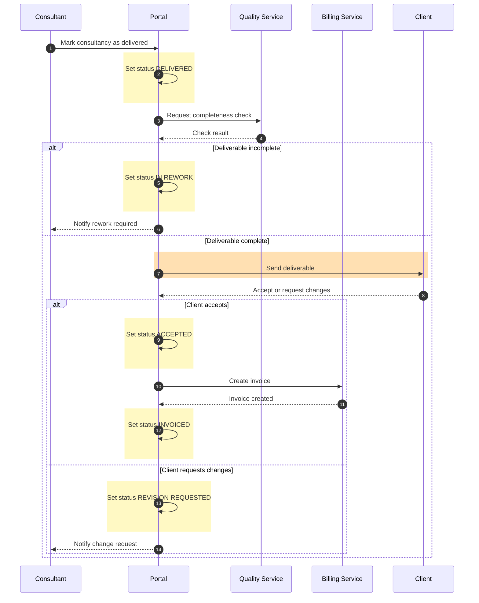

# Sequence diagram

## Scopo
Mostrare **l'ordine temporale dei messaggi** tra attori e sistemi: chi chiama chi, cosa risponde, cosa succede in caso di errore o timeout.

## Quando usarlo
- Integrazioni API, orchestrazione tra servizi, protocolli
- Debug o design di flussi dove l'ordine e le risposte contano
- Dettaglio di *un singolo passo* di un flowchart più grande

## Quando NON usarlo
- Logica di business con molti rami: diventa illeggibile → flowchart.

## Come costruirlo
1. `participant` con alias in inglese, nell'ordine in cui compaiono.
2. `autonumber` per riferirsi ai passi.
3. Frecce `->>` per richieste, `-->>` per risposte.
4. Rami con `alt / else / end`, cicli con `loop`, parallelismo con `par`.
5. **Colori**: le sequence non supportano `classDef`. Adatta la palette con blocchi `rect rgb(...)`:
   - status update → `rect rgb(255, 249, 196)` (giallo chiaro)
   - action/operazione di business → `rect rgb(255, 224, 178)` (arancione chiaro)
   - decision → il blocco `alt` stesso (nota: non è colorabile in modo portabile; usa `Note over` con testo `Decision: ...` se serve enfasi)
6. Dichiara il mapping dei colori in un commento `%%` in testa.

## Esempio finito

