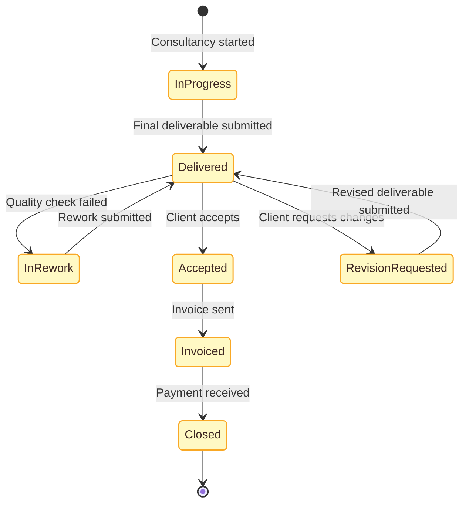

# State diagram

## Scopo
Definire il **ciclo di vita di un'entità**: stati ammessi e transizioni lecite (e chi/cosa le innesca).

## Quando usarlo
- Si vuole validare o documentare il modello di stato (pratica, ordine, ticket, consulenza)
- Serve il "contratto" degli stati da tenere coerente con flowchart e codice

## Come costruirlo
1. `stateDiagram-v2`, stati in inglese `UPPER_SNAKE` o Title Case, coerenti **ovunque** (stessi nomi dei box `Status: X` nei flowchart).
2. Etichetta ogni transizione con l'evento/azione che la causa (`: Deliverable accepted`).
3. Stato iniziale `[*]`, stati finali `--> [*]`.
4. Stili: tutti gli stati sono "status" → colora con `classDef status` e `class` sugli stati. Le transizioni non hanno colore.
5. Non modellare le decision come stati: la condizione va nell'etichetta della transizione.

## Esempio finito

## Controllo di coerenza
Se esiste anche un flowchart dello stesso processo, ogni `Status: VALUE` del flowchart deve corrispondere a uno stato qui, e viceversa. Segnala le differenze all'utente.
