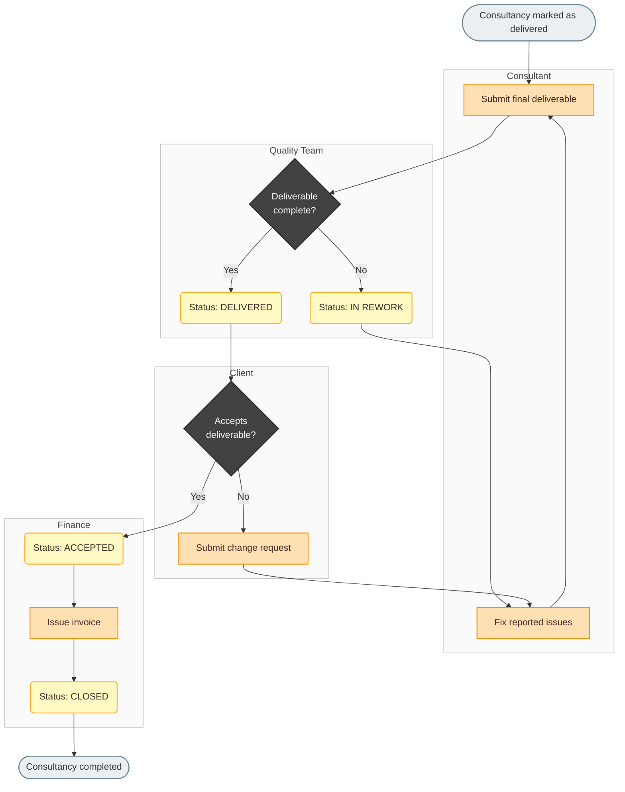

# Swimlane (flowchart per attore)

## Scopo
Mostrare **chi** fa cosa e dove avvengono gli handoff tra attori/team/sistemi.

## Quando usarlo
- ≥3 attori e le responsabilità sono il punto della discussione
- Audit, compliance, RACI impliciti (utile in contesti regolamentati)
- Si vogliono individuare colli di bottiglia negli handoff

Con un solo attore usa il process flowchart.

## Come costruirlo
1. Un `subgraph` per attore, con ID e titolo in inglese (`subgraph consultant["Consultant"]`).
2. Dentro ogni lane, **solo i nodi** di quell'attore; gli archi tra lane si dichiarano **fuori** dai subgraph.
3. Applica `class laneId lane` per lo stile neutro delle lane (non usare i 3 colori semantici sulle lane).
4. Direzione `flowchart LR` se le lane sono pochissime e il flusso lungo; `TD` come default.
5. Mantieni stesse regole di colore/forma/classDef del process flowchart.

## Esempio finito

## Note
- Mermaid non ha vere "corsie" orizzontali: i subgraph sono raggruppi. In `TD` le lane si impilano in base al flusso; è normale e leggibile.
- L'assegnazione di un box a una lane è un'**assunzione di responsabilità**: se la descrizione non la dice, dichiarala in *Assumptions*.
