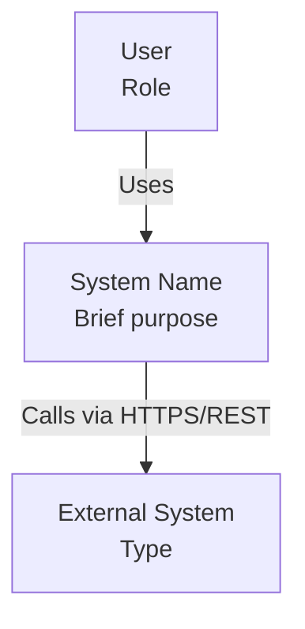
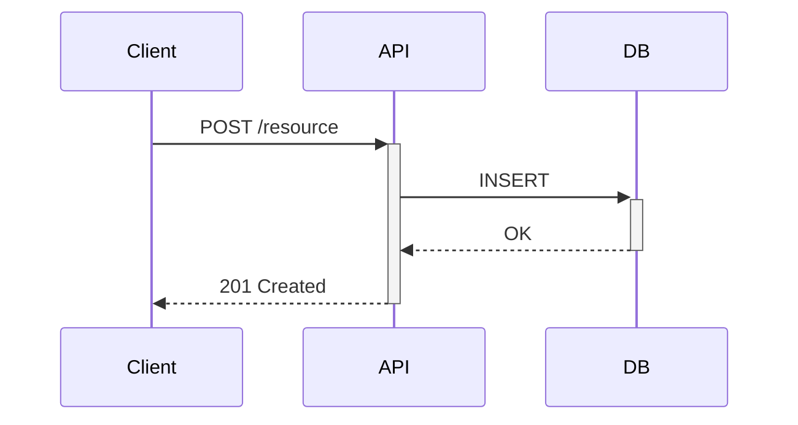

# EAS Architecture Documentation Generator

Transform unstructured input (notes, conversations, specs) into professional architectural
documentation following C4, 4+1 Views, or Arc42 frameworks.

---

## Step 1 — Information Gathering

Extract from user input:

**Functional**: system purpose, key use cases, business drivers  
**Technical**: tech stack, integrations, protocols, data flows, deployment model  
**Quality attributes**: performance targets, security concerns, scalability, availability  
**Constraints**: tech limitations, budget, timeline, team skills

If input is too thin to proceed, ask ONE focused question covering the biggest gap.

---

## Step 2 — Framework Selection

Pick the right framework, or ask if unclear:

| Situation                                             | Recommended    |
| ----------------------------------------------------- | -------------- |
| Modern cloud-native / microservices, agile teams      | **C4 Model**   |
| Complex enterprise system, multiple stakeholder types | **4+1 Views**  |
| Long-lived system, regulatory, complete reference doc | **Arc42**      |
| Systems with frequent changes and traceability needs  | **ADR-linked** |

When in doubt, default to **C4** (lightweight, easy to extend later).

Read the relevant reference file before writing:

- C4 → `references/c4-guide.md`
- 4+1 → `references/4plus1-guide.md`
- Arc42 → `references/arc42-guide.md`
- Diagrams → `references/diagram-practices.md`

---

## Step 3 — Content Organization

### C4 Model — 4 levels of abstraction

1. **Context**: system + users + external systems
2. **Container**: deployable units (app, DB, message broker…)
3. **Component**: internal structure of a container
4. **Code**: (skip in manual docs; auto-generate from code)

Mandatory per container: Name | Technology | Responsibilities | Dependencies

### 4+1 Views — 5 perspectives

1. **Logical**: domain model, key abstractions (class diagrams)
2. **Process**: runtime behavior, concurrency, state machines
3. **Development**: module/package structure, build, testing strategy
4. **Physical**: deployment topology, network, HA, DR
5. **Scenarios (+1)**: use cases that tie all views together

### Arc42 — 12 sections (all must be touched)

1 Intro & Goals → 2 Constraints → 3 Context → 4 Solution Strategy →
5 Building Blocks → 6 Runtime → 7 Deployment → 8 Crosscutting Concepts →
9 Decisions (ADRs) → 10 Quality → 11 Risks & Tech Debt → 12 Glossary

---

## Step 4 — Diagram Generation (Mermaid)

Always use Mermaid syntax. Key patterns:





**Diagram rules:**

- 5–9 elements per diagram max
- Label ALL relationships (protocol + purpose)
- Solid arrows = sync, dashed = async
- Colors: blue=internal, gray=external, green=datastore, yellow=queue
- One diagram answers ONE question

---

## Step 5 — Quality Checklist

Before output, verify:

- [ ] All stakeholder concerns covered
- [ ] Consistent terminology (use glossary for domain terms)
- [ ] Diagrams match text descriptions
- [ ] Appropriate abstraction level (no code in context diagrams)
- [ ] Every diagram has a title and accompanying explanation
- [ ] Quality attributes are explicit (no vague "high performance")
- [ ] Decisions include rationale ("why", not just "what")
- [ ] Cross-references are correct

---

## Writing Style Rules

- **Active voice**: "The API Gateway routes requests" ✅ / "Requests are routed" ❌
- **Specific**: "Handles 10K req/s" ✅ / "High performance" ❌
- **Technology-explicit**: "PostgreSQL 15" ✅ / "A database" ❌
- **Define acronyms** on first use
- **Justify decisions**: always explain the "why"

---

## Output Format

```markdown
# [System Name] — Architecture Documentation

## Document Info

- **Version**: 1.0 | **Date**: YYYY-MM-DD | **Status**: Draft

## 1. Introduction

### 1.1 Purpose / 1.2 Scope / 1.3 Definitions

## 2. System Context

[Context diagram + description]

## 3–N. [Framework-specific sections]

...

## Appendices

- A. References | B. ADRs | C. Revision History
```

---

## Common Pitfalls to Avoid

❌ Too much detail too early — start high-level  
❌ Implementation details instead of architecture  
❌ Inconsistent terminology — define once, use everywhere  
❌ Orphaned diagrams — every diagram needs text context  
❌ Missing quality attributes — security, perf, scalability must be explicit  
❌ Static docs — include evolution path and known risks

---

## Reference Files

Load these as needed (don't load all upfront):

| File                                       | When to read                                                      |
| ------------------------------------------ | ----------------------------------------------------------------- |
| `references/c4-guide.md`                   | Generating C4 Context/Container/Component diagrams                |
| `references/4plus1-guide.md`               | Generating any of the 5 views                                     |
| `references/arc42-guide.md`                | Filling Arc42 12-section template                                 |
| `references/diagram-practices.md`          | Any Mermaid diagram generation                                    |
| `references/quality-attributes-catalog.md` | Common quality attributes reference                               |
| `examples/doc_example_c4_complete.md`      | Example of complete C4 documentation, for Order Management System |

---

## Immediate Action

After reading this skill:

1. Identify which framework fits (or ask)
2. List any critical info gaps (max 1 question)
3. Start with the highest-level diagram (Context or equivalent)
4. Progressively add detail — never start from the bottom up

## Reference Materials

Check `Examples/` for:

- `example-c4-complete.md` - Full C4 documentation example
- `example-4plus1-views.md` - Complete 4+1 Views example
- `example-arc42-system.md` - Arc42 documentation example
- `example-prompts.md` - Sample prompts for different scenarios
